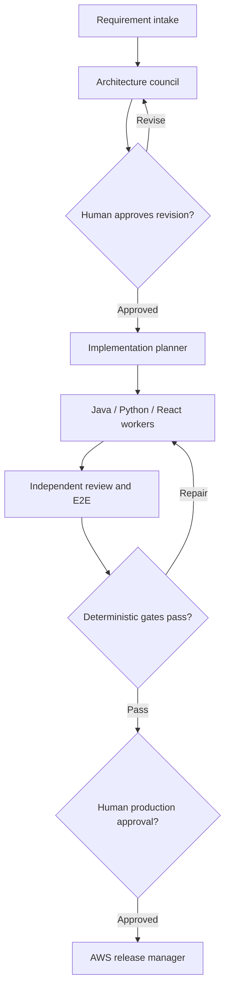

# Governed Software Factory

[](https://github.com/OWNER/REPOSITORY/actions/workflows/ci.yml)

A production-oriented reference implementation for treating the SDLC as an assembly line of specialized agents. It coordinates architecture, planning, Java/Python/React implementation, E2E verification, security review, and AWS release preparation while preserving human control of architecture and production deployment.

The factory does not equate consensus with correctness. Councils vote on reversible design choices. Objective failures, security/data-loss/compliance findings, unmet requirements, and human approval gates cannot be overruled. When an absolute majority is absent, the controller uses a documented adversarial maximin rule. Exact ties and high-impact uncertainty go to a human architect.

## Assembly line



Agent communication is stored as structured, append-only events with a hash chain. Each handoff carries requirement IDs, artifact hashes, assumptions, scope, acceptance criteria, and evidence. A controller derives lifecycle state; agents cannot declare global success.

## Roles

| Stage | Agents | Model tier | Mutation authority |
| --- | --- | --- | --- |
| Intake | Product analyst | High | Requirements only |
| Architecture | Architect, security, independent reviewer | High | Architecture documents |
| Planning | Planner, quality, reviewer | High | Work packets |
| Implementation | Java, Python, React workers | Lower | Assigned worktree paths |
| Verification | Quality, security, reviewer | High | Evidence only |
| Release | Release manager | High | Approved immutable artifact |

The default configuration uses role labels rather than vendor-specific model names. Replace `high-model-id` and `low-model-id` with explicit models available in your Codex, Claude Code, or Copilot environment. Never use `auto` or `inherit` for enforced tier separation.

## Quick start

```bash
python3 -m venv .venv
. .venv/bin/activate
python -m pip install -e '.[dev]'
software-factory validate-config config/factory.example.yaml
pytest
```

Install the reusable skill from `skills/software-factory` in your agent host. The skill defines the lifecycle and references the repository controller. Host credentials and research tools remain external configuration.

Blueprints provide small, auditable starting points for Java, Python, React/Playwright, and AWS Terraform. They are reference templates, not claims of production readiness. Copy them into a new product repository and tailor reliability, data, security, cost, and compliance requirements before deployment.

## Governance guarantees

- Architecture and production deployments require approval of exact hashes/digests.
- Implementers cannot review their own work.
- Council membership is odd, at least three, and each agent gets one evidence-backed vote.
- Majority means more than half of all eligible voters.
- Safety gates veto voting outcomes.
- Missing evidence and maximin ties escalate to humans.
- Production corrections are never autonomous.
- AWS uses OIDC and protected GitHub Environments; long-lived cloud keys are excluded.

See [governance](GOVERNANCE.md), [architecture](docs/architecture/software-factory.md), [security](SECURITY.md), and [contributing](CONTRIBUTING.md).

## Status

This is a reference implementation. Local unit tests validate governance, state transitions, configuration, and ledger tamper detection. Real-world reliability requires live agent-host tests, repository protections, AWS integration tests, threat modeling, disaster-recovery exercises, and operating evidence for your environment.


### Company Brain

The factory now includes `factory-company-brain`, a high-tier employee context agent
installed for all three hosts. Its local persistent knowledge store preserves source
revisions and supplies bounded, cited context packets across sessions. Start with
[Company Brain onboarding and boundaries](skills/software-factory/references/company-brain.md).
Import approved company documents once using `brain-ingest`, then retrieve task-specific
context using `brain-query`. Knowledge is not preloaded; connected services and host
access controls must be provisioned separately. The role does not bypass council,
quality, or human approval gates.

### Prompt Refiner

`factory-prompt-refiner` turns intake requests into traceable requirements and
observable acceptance criteria before architecture. It preserves the original
request, cites Company Brain context, separates assumptions from facts and asks
consequential clarification questions. Every refined brief requires explicit human
review and approval of its revision and artifact hash before architecture handoff;
changes require renewed approval. See the
[prompt refinement workflow](skills/software-factory/references/prompt-refiner.md).
The existing installer generates this high-tier role for all three clients.
This is an agent workflow and output contract; the CLI does not automatically
invoke or validate its output. Existing architecture and release gates still apply.
