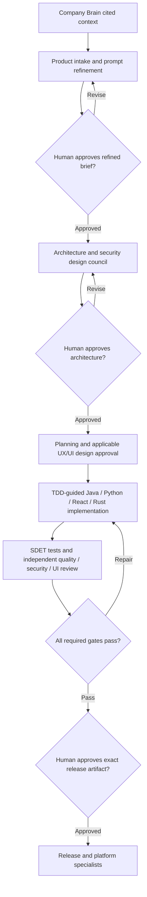

# Governed Software Factory

[](https://github.com/OWNER/REPOSITORY/actions/workflows/ci.yml)

A production-oriented reference implementation for treating the SDLC as an assembly line of specialized agents. It coordinates architecture, planning, Java/Python/Rust/React implementation, Rust GTK4/Iced desktop apps, E2E verification, security review, and AWS release preparation while preserving human control of architecture and production deployment.

The factory does not equate consensus with correctness. Councils vote on reversible design choices. Objective failures, security/data-loss/compliance findings, unmet requirements, and human approval gates cannot be overruled. When an absolute majority is absent, the controller uses a documented adversarial maximin rule. Exact ties and high-impact uncertainty go to a human architect.

## Assembly line



The version-two workflow controller enforces refined-brief, architecture and plan
approvals, plus UI approval when frontend work is enabled. Local verification
stops before deployment; isolated deployment requires configured trusted adapters.

Agent communication is stored as structured, append-only events with a hash chain. Each handoff carries requirement IDs, artifact hashes, assumptions, scope, acceptance criteria, and evidence. A controller derives lifecycle state; agents cannot declare global success.

## Roles

| Stage | Agents | Model tier | Mutation authority |
| --- | --- | --- | --- |
| Context and intake | Company Brain, product, prompt refiner | High | Approved knowledge imports and requirement briefs |
| Architecture | Architect, security architect; independent security, quality, reviewer | High | Architecture and threat-model artifacts |
| Design and planning | UX, UI, planner, code mapper | High | Design specifications, repository maps and work packets |
| Implementation | Java, Python, React, Rust workers | Lower | Assigned implementation and test paths |
| Test development | TDD guide, SDET | High | Requirement-based tests and execution evidence |
| Platform | DevOps, network, observability | High | Scoped infrastructure and telemetry work with applicable approvals |
| Verification | Quality, security, reviewer | High | Independent test, security and frontend review evidence |
| Release | Release manager | High | Explicitly approved immutable artifact |
| Optional improvement | Improvement proposer, evaluation judge | High | Inert overlays and independent comparison evidence |

The installer and example configuration define 26 roles. The architecture council
has five members: architect, security architect, security, quality and reviewer.
Implementation and release councils each have three members.

The default configuration uses role labels rather than vendor-specific model names. Replace `high-model-id` and `low-model-id` with explicit models available in your Codex, Claude Code, or Copilot environment. Never use `auto` or `inherit` for enforced tier separation.

## Quick start

```bash
python3 -m venv .venv
. .venv/bin/activate
python -m pip install -e '.[dev]'
software-factory validate-config config/factory.example.yaml
pytest
```

Install the reusable skill from `skills/software-factory` in your agent host. The skill defines the lifecycle and references the repository controller. Host credentials and research tools remain external configuration.

Blueprints provide small, auditable starting points for Java, Python, React/Playwright, and AWS Terraform. They are reference templates, not claims of production readiness. Copy them into a new product repository and tailor reliability, data, security, cost, and compliance requirements before deployment.

## Governance requirements

- Architecture and production deployments require approval of exact hashes/digests.
- Implementers cannot review their own work.
- Council membership is odd, at least three, and each agent gets one evidence-backed vote.
- Majority means more than half of all eligible voters.
- Safety gates veto voting outcomes.
- Missing evidence and maximin ties escalate to humans.
- Production corrections are never autonomous.
- The AWS workflow uses OIDC; operators must configure protected GitHub Environments and role trust policies.

These are workflow requirements, not a complete security boundary. See the
[architecture enforcement boundaries](docs/architecture/software-factory.md#enforcement-boundaries).

See the [local operations guide](docs/operations/local-workflows.md), [governance](GOVERNANCE.md), [architecture](docs/architecture/software-factory.md), [security](SECURITY.md), and [contributing](CONTRIBUTING.md).

## Status

This is a reference implementation. Local unit tests cover governance, state transitions, configuration, ledger tamper detection and channels, Company Brain retrieval, and improvement evaluation/selection rules. Real-world reliability requires live agent-host tests, repository protections, AWS integration tests, threat modeling, disaster-recovery exercises, and operating evidence for your environment.


## Extended workflows

### Company Brain

The factory now includes `factory-company-brain`, a high-tier employee context agent
available through the installer for all three supported hosts. Its local persistent knowledge store preserves source
revisions and supplies bounded, cited context packets across sessions. Start with
[Company Brain onboarding and boundaries](skills/software-factory/references/company-brain.md).
Import approved company documents once using `brain-ingest`, then retrieve task-specific
context using `brain-query`. Knowledge is not preloaded; connected services and host
access controls must be provisioned separately. The role does not bypass council,
quality, or human approval gates.

### Prompt Refiner

`factory-prompt-refiner` turns intake requests into traceable requirements and
observable acceptance criteria before architecture. It preserves the original
request, cites Company Brain context, separates assumptions from facts and asks
consequential clarification questions. Every refined brief requires explicit human
review and approval of its revision and artifact hash before architecture handoff;
changes require renewed approval. See the
[prompt refinement workflow](skills/software-factory/references/prompt-refiner.md).
The existing installer generates this high-tier role for all three clients.
This is an agent workflow and output contract; the CLI does not automatically
invoke or validate its output. Existing architecture and release gates still apply.

### TDD and SDET

The factory includes high-tier `factory-tdd-guide` and `factory-sdet` roles.
Implementation follows red-green-refactor; SDET designs and implements E2E tests
for all approved requirements, and the quality agent independently verifies them.
Default release gates include `tdd` and `e2e-coverage`. Read the
[TDD and SDET workflow](skills/software-factory/references/tdd-sdet.md) for evidence,
coverage and nonproduction environment requirements. Project-specific E2E tests
are written when a concrete approved requirement and service are supplied.

### Platform specialists and channels

The existing security reviewer and implementation planner are extended, with new
high-tier code mapper, DevOps, network and observability agents. They prioritize
least privilege, limited blast radius, secure networking and verified telemetry.
Default release prerequisites include network-security and observability evidence.
The ledger supports `send --channel NAME` and `inbox --channel NAME` for human-readable
agent discussions. See [specialist responsibilities and channels](skills/software-factory/references/platform-specialists.md).
Infrastructure provisioning requires separately configured credentials, independent
review and explicit human approval; agents are not installed or invoked automatically.

### Security Architect

`factory-security-architect` partners with the architect on threat models, trust
boundaries, secure design options and requirement-to-control/test traceability.
The separate security reviewer independently critiques their design before human
architecture approval. See [secure architecture workflow](skills/software-factory/references/security-architecture.md).
The example architecture council now has five members, including Security Architect.

### UX, UI and frontend review

High-tier UX and UI specialists create evidence-backed flows and accessible,
responsive specifications before frontend implementation. Human design review
precedes dependent tasks. The existing reviewer explicitly covers React/UI code,
security, accessibility, rendered behavior and approved-design conformance.
Design discussions use `factory-design`; see the
[UX/UI workflow and review criteria](skills/software-factory/references/ux-ui.md).

### Prompt and workflow improvement

An optional SIFT-inspired loop archives inert prompt/workflow overlays, records
actual evaluation evidence, ranks smoke-tested candidates with pairwise judging,
and requires benchmark improvement, independent review and exact human approval
before recording a selection. It never modifies live agents or factory policy.
Use `software-factory improvement --help` and the
[improvement workflow](skills/software-factory/references/improvement.md).
Two new high-tier agents propose and judge improvements. Execution, spend limits,
model verification and human authentication remain responsibilities of the host
and evaluation harness; automatic experimentation/adoption is not implemented.


### Company Brain semantic retrieval

Company Brain now supports optional local vector/hybrid search using sqlite-vec,
FastEmbed and FTS5. Existing SQLite documents are preserved; index approved sources
with `brain-index`, then query with `brain-query --mode hybrid` (or `vector`). Install
with `.venv/bin/python -m pip install -e '.[brain]'`. Legacy queries remain lexical.
See [Company Brain migration and limits](skills/software-factory/references/company-brain.md).
This is exact filtered search, with chunk citations and stale-index rejection;
learned-model quality and workload speedups require real corpus evaluation.

### Human-approved project knowledge updates

Project milestones now produce reviewable Company Brain proposals. Independent
review and interactive human approval precede publication. `brain-updates publish`
imports the exact approved document and rebuilds vector retrieval; indexing failure
is retryable without duplicate import. Inspect proposed/previous content and read
the dedicated event stream with `brain-updates inspect` and `brain-updates events`.
See the [knowledge handoff workflow](skills/software-factory/references/knowledge-updates.md).
Host agents invoke this workflow; no background scanner is added, and local caller
identity/approval permissions must be enforced by the host.


### Reverse Engineer

The high-tier `factory-reverse-engineer` reconstructs existing system behavior,
contracts and TOGAF-aligned baseline architecture from cited code and runtime
evidence. It collaborates with Code Mapper and hands independently reviewed
findings to architect, planner, SDET and Company Brain. Discovery uses
`factory-discovery`; see the [reverse-engineering workflow](skills/software-factory/references/reverse-engineering.md).
The installer now generates 26 agents. Discovery does not authorize target-system
modification, cloud mutation or knowledge publication.

### Enforced execution and handoffs

Run new initiatives through `software-factory workflow`, using an operator-reviewed
manifest derived from `config/workflow.example.json`. See
[the controller contract](skills/software-factory/references/enforced-workflow.md)
for setup, commands, evidence schemas and isolation requirements. Reinstalling
agent prompts alone does not activate orchestration: configure the project's
actual worker/test/deployment commands and run the controller.

The controller serializes and persists every handoff, executes checks, blocks
missing approvals, protects tests between red and green, verifies independent
reviewer assignments, detects stale source/evidence, and binds deployment to the
approved artifact. It provides a readable `factory-handoffs` event stream.
Legacy `FactoryState` objects remain planning simulations and cannot authorize
execution through this controller. Use an isolated controller principal and
restricted worker adapters; the skill installer does not provision those host or
AWS permissions. Semantic correctness and authentic identities still depend on
reviewers and trusted runtime adapters.

### Version 0.2: spec-driven workflows

New work uses workflow schema version 2. Start with a specification containing
requirement IDs and observable acceptance criteria, then let the planner generate
a task graph after architecture approval. Human plan approval precedes real TDD.
Every acceptance criterion must reference passing JUnit evidence. A council cannot
vote through disqualifiers or decide without complete independent assessments.

```bash
python3 -m pip install -e '.[brain]'
python3 scripts/init_spec_workflow.py \
  --repository /path/to/project \
  --spec /path/to/project/spec.json \
  --checks /path/to/project/checks.json \
  --host claude --high-model YOUR_HIGH_MODEL_ID --low-model YOUR_LOW_MODEL_ID \
  --output /path/to/controller/workflow.json
software-factory workflow doctor \
  --database /path/to/controller/run.db \
  --manifest /path/to/controller/workflow.json \
  --repository /path/to/project
```

Choose `--host codex` or `--host copilot` for the other clients. Use
`--task-templates` for reviewed Java/React templates, `--frontend` for UI gates,
and `--existing-system` for discovery. The default template is Python. Provide
actual gate adapters using `config/checks.example.json` as a shape reference;
placeholder adapters fail the doctor check. Add `.factory-state/` and test/build
caches to the project's ignore file before execution.

Then run `workflow next` with the same paths; use `workflow approve` at human
gates. Read [the spec workflow](skills/software-factory/references/spec-driven-development.md)
and [runtime/evidence contracts](skills/software-factory/references/enforced-workflow.md).
Re-run the client installer with `--replace` after reviewing local customizations
to refresh the skill and its 26 agents. Installing prompts alone does not start
the controller or provision runtime security.

Old run databases are not migrated into new approvals. Retain them as history,
create a new version-two manifest/database, and obtain new approvals. Task repair
can preserve valid earlier work within one run; arbitrary spec/architecture
changes deliberately require fresh approvals.

Local mode supports development and verification, not production deployment.
Production requires a provisioned privileged controller, separate worker
principals, trusted signed telemetry/ballots, protected approval keys, immutable
adapters/artifacts and independent deployment observation. The stock native CLI
adapter does not supply a trusted telemetry broker. Live Claude/Codex/Copilot and
AWS integration must be validated in the operator's environment before release.
